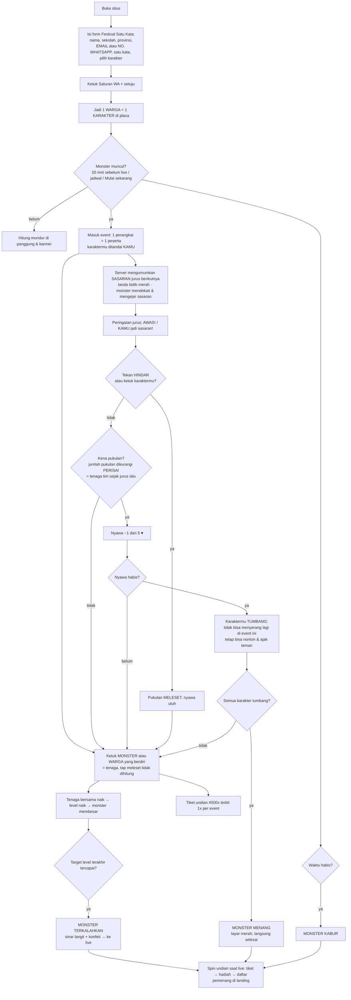

# Alur Lawan Monster (setelah daftar)

## Aturan karakter

| Aturan | Keterangan |
|---|---|
| 1 pendaftar = 1 karakter | Identitas = email **atau** nomor WhatsApp (format 08…/+62… disamakan). 1 email/nomor = 1 warga. |
| 1 perangkat = 1 peserta | HP terikat ke satu identitas; ganti HP → admin "Lepas ikatan". |
| Populasi event | Semua warga festival. Jumlah hidup tampil di HUD: **Warga hidup X / Y**. |
| Nyawa | Tiap karakter punya `monster_hp_warga` nyawa (bawaan 5 ♥). Tiap pukulan −1, tumbang di 0. |
| Sasaran | Dipilih server SEBELUM jurus (diumumkan di status `jurusTarget`), diberi tanda bidik; monster mendekati & mengejar sasaran. |
| Jurus | Tiap `monster_jurus_detik` (bawaan 8 dtk). Jumlah pukulan = populasi awal × `monster_jurus_damage`% × skala level × (1 − perisai), minimal 1. |
| Perisai | Tenaga yang terkumpul sejak jurus sebelumnya ≥ `monster_perisai`% target level → menahan sampai 80%. |
| HINDAR | Hanya di jendela peringatan (≤ 2,5 dtk sebelum jurus). Pukulan ke karaktermu meleset untuk jurus itu. |
| Tumbang | Tap ditolak server (`mati: true`). Tidak bisa dibangkitkan dalam event yang sama. |
| Akhir | Monster kalah (target tercapai) · Monster menang (semua karakter tumbang) · Monster kabur (waktu habis). |

Endpoint: lihat `docs/API.md` → Lawan Monster (`masuk`, `tap`, `hindar`, `saya`).
